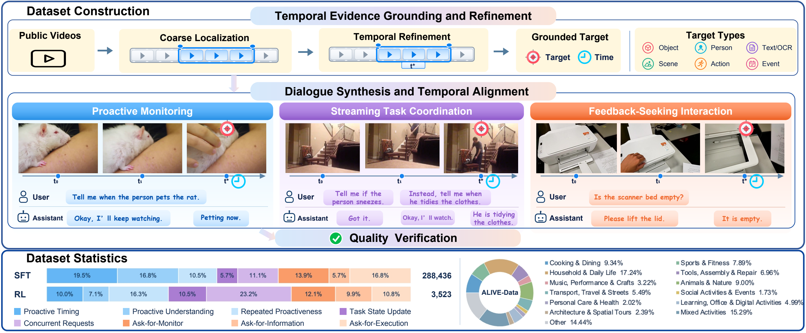
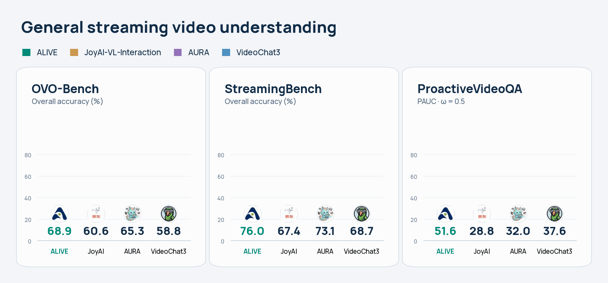

<p align="center">
  
</p>

<h1 align="center">ALIVE: Making Streaming Video Models Interactive</h1>

<p align="center">
  <a href="https://arxiv.org/abs/2611.21366"></a>
  <a href="https://huggingface.co/ALIVE-Team/ALIVE"></a>
  <a name="dataset-coming-soon"></a>
  <a name="fsi-bench-coming-soon"></a>
  <a href="https://lijinzhao30.github.io/ALIVE/"></a>
  <a href="https://lijinzhao30.github.io/ALIVE/#demo"></a>
</p>

<p align="center">
  Jinzhao Li<sup>1,3,*</sup> · Yuan Xu<sup>2,3,*</sup> · Jinxuan Wu<sup>4</sup> · Yukun Wang<sup>1</sup> · Yijia Lei<sup>1</sup> · Hanyu Ji<sup>2</sup> · Yinuo Chen<sup>1</sup> · Zining Huang<sup>1</sup><br>
  Chi Zhang<sup>1</sup> · Hang Ye<sup>2</sup> · Yiwu Zhong<sup>2</sup> · Honglei Yan<sup>3</sup> · Panwang Pan<sup>3</sup> · Yizhou Wang<sup>2</sup> · Yin Li<sup>5</sup> · Miao Liu<sup>1,†</sup>
</p>

<p align="center">
  <sup>1</sup> Tsinghua University &nbsp; <sup>2</sup> Peking University &nbsp; <sup>3</sup> ByteDance<br>
  <sup>4</sup> Beihang University &nbsp; <sup>5</sup> University of Wisconsin–Madison<br>
  <sub>* Equal contribution &nbsp; † Corresponding author</sub>
</p>

<p align="center"><b>An interactive streaming video model for proactive monitoring,<br>streaming task coordination, and feedback-seeking interaction.</b></p>

## Demo

<a href="https://lijinzhao30.github.io/ALIVE/#demo"></a>

<p align="center"><a href="https://lijinzhao30.github.io/ALIVE/#demo"><b>▶ Watch the full demo · 4:38 · English + 中文</b></a> &nbsp; · &nbsp; <a href="https://raw.githubusercontent.com/lijinzhao30/ALIVE/main/docs/assets/alive-demo.mp4?v=d025a883b7ac">Download MP4</a></p>

<p align="center">
  <b>More demos:</b>
  <a href="https://lijinzhao30.github.io/ALIVE/#realworld-demos">Real-world live conversations ↗</a>
  &nbsp; · &nbsp;
  <a href="https://lijinzhao30.github.io/ALIVE/#webvideo-demos">Web-video demos ↗</a>
</p>

## Overview

Streaming video LLMs can continuously observe the world, yet often handle user requests in isolation. **ALIVE** turns them into interactive assistants with three capabilities:

| Capability | What ALIVE does |
| :--- | :--- |
| 🔵 **Proactive Monitoring** | Monitor unfolding events and respond when the requested condition is met. |
| 🟣 **Streaming Task Coordination** | Maintain multiple requests and update active tasks as instructions change. |
| 🟠 **Feedback-Seeking Interaction** | Ask for clarification, request a concrete user action, or propose continued monitoring when more evidence is needed. |

<p align="center">
  <a href="docs/assets/figures/teaser.png"></a>
</p>

## Quick Start

Run the ALIVE browser demo locally with streaming speech recognition and speech synthesis on **two GPUs**: one for ALIVE and one shared by ASR/TTS (Linux, Python 3.12).

| Component | Hugging Face checkpoint |
| :--- | :--- |
| ALIVE | [ALIVE-Team/ALIVE](https://huggingface.co/ALIVE-Team/ALIVE) (`ALIVE-8B`) |
| ASR | [Qwen/Qwen3-ASR-1.7B](https://huggingface.co/Qwen/Qwen3-ASR-1.7B) |
| TTS | [Qwen/Qwen3-TTS-12Hz-1.7B-CustomVoice](https://huggingface.co/Qwen/Qwen3-TTS-12Hz-1.7B-CustomVoice) |

`setup.py` installs the isolated environments and downloads the ASR/TTS checkpoints; download ALIVE-8B separately:

```bash
git clone https://github.com/lijinzhao30/ALIVE.git
cd ALIVE/Web_Inference

python3.12 scripts/setup.py
huggingface-cli download ALIVE-Team/ALIVE --include "ALIVE-8B/*" --local-dir models/ALIVE

cp config.example.json config.json         # set "model_path": "models/ALIVE/ALIVE-8B"
python3.12 start.py                        # open https://localhost:8090
```

See the [web inference guide](Web_Inference/README.md) for details.

## Data

We build **ALIVE-SFT-288K** for supervised fine-tuning and **ALIVE-RL-3K** for reinforcement learning.

<p align="center">
  <a href="docs/assets/figures/dataset.png"></a>
</p>

## Method

ALIVE is trained in two stages:

- **Contrastive supervised fine-tuning** teaches when and how to respond.
- **Reinforcement learning with Behavior-Aligned Credit Assignment (BACA)** refines decisions, responses, and silence across multi-turn interactions.

<p align="center">
  <a href="docs/assets/figures/method.png"></a>
</p>

## Benchmark

- We introduce **FSI-Bench** to evaluate whether streaming video LLMs, when the current context is insufficient to resolve a request, can identify the missing prerequisite, actively seek the required feedback, and complete the task.
- ALIVE achieves the highest overall scores among the compared models on four public benchmarks and FSI-Bench, demonstrating strong streaming understanding and interactive capabilities.

<p align="center">
  <a href="docs/assets/benchmarks-understanding.png"></a>
</p>

<p align="center">
  <a href="docs/assets/benchmarks-interaction.png"></a>
</p>

## TODO

- [x] Paper
- [x] ALIVE-8B checkpoint
- [x] Local web inference
- [ ] Benchmark and evaluation code
- [ ] Training data

## Citation

```bibtex
@misc{li2026alivemakingstreamingvideo,
      title={ALIVE: Making Streaming Video Models Interactive},
      author={Jinzhao Li and Yuan Xu and Jinxuan Wu and Yukun Wang and Yijia Lei and Hanyu Ji and Yinuo Chen and Zining Huang and Chi Zhang and Hang Ye and Yiwu Zhong and Honglei Yan and Panwang Pan and Yizhou Wang and Yin Li and Miao Liu},
      year={2026},
      eprint={2611.21366},
      archivePrefix={arXiv},
      primaryClass={cs.CV},
      url={https://arxiv.org/abs/2611.21366},
}
```

## License

Code is released under the [Apache License 2.0](LICENSE). See [third-party notices](THIRD_PARTY_NOTICES.md) and [asset credits](docs/assets/CREDITS.md).
