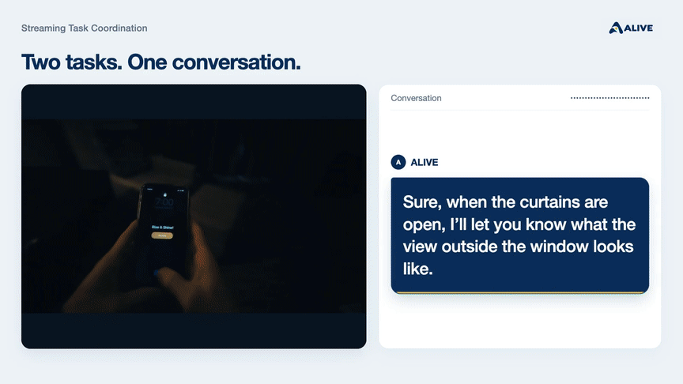
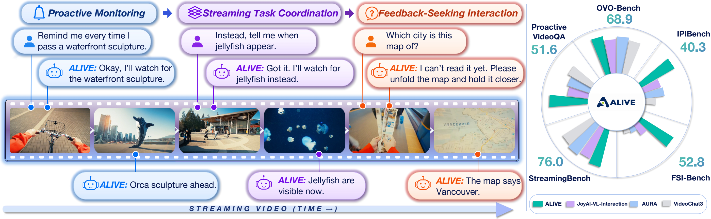
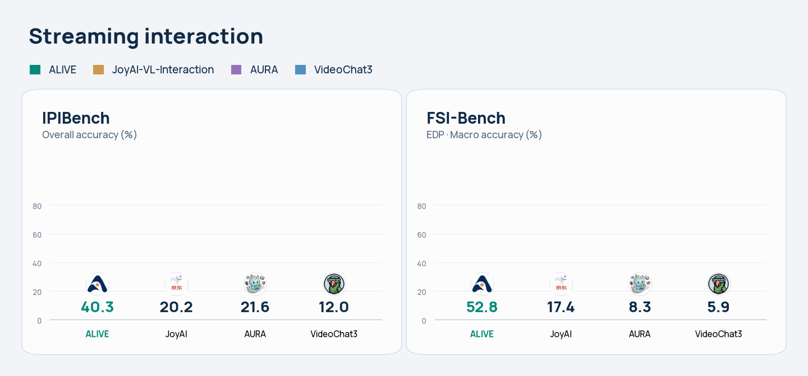
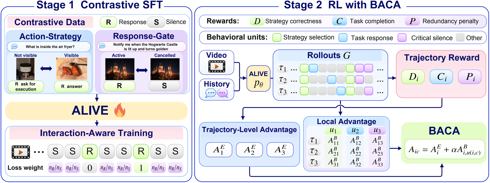

  

<h1 align="center">ALIVE: Making Streaming Video Models Interactive</h1>

  
  
  
  
  

<b>Continuously perceive. Coordinate evolving tasks. Seek the feedback needed to proceed.</b>

  Jinzhao Li1,3,* · Yuan Xu2,3,* · Jinxuan Wu4 · Yukun Wang1 · Yijia Lei1 · Hanyu Ji2 · Yinuo Chen1 · Zining Huang1 
  Chi Zhang1 · Hang Ye2 · Yiwu Zhong2 · Honglei Yan3 · Panwang Pan3 · Yizhou Wang2 · Yin Li5 · Miao Liu1,†

  1 Tsinghua University &nbsp; 2 Peking University &nbsp; 3 ByteDance 
  4 Beihang University &nbsp; 5 University of Wisconsin–Madison 
  * Equal contribution &nbsp; † Corresponding author

## Demo

Watch ALIVE demonstrate **Streaming Task Coordination** and **Feedback-Seeking Interaction** in English and Chinese. Click the preview to watch the full narrated demo.

<a href="https://lijinzhao30.github.io/ALIVE/#demo"><b>▶ Watch the full demo · 4:38 · English + 中文</b></a> &nbsp; · &nbsp; <a href="https://raw.githubusercontent.com/lijinzhao30/ALIVE/main/docs/assets/alive-demo.mp4">Download MP4</a>

## Toward interactive streaming

Streaming video models can continuously observe the world, yet often handle user requests in isolation. **ALIVE** moves toward sustained interaction: it responds at the right moment, coordinates evolving tasks, and actively seeks missing information or visual evidence.

| 🔵 Proactive Monitoring | 🟣 Streaming Task Coordination | 🟠 Feedback-Seeking Interaction |
| --- | --- | --- |
| Monitor unfolding events and respond when the requested condition is met. | Maintain multiple requests and update active tasks as instructions change. | Ask for clarification, request a concrete user action, or propose continued monitoring when more evidence is needed. |

ALIVE brings together a new interaction setting, large-scale training data, and a two-stage learning framework. It achieves the **highest overall scores among the models compared in the paper on all five benchmarks**, covering both general streaming video understanding and streaming interaction.

## Benchmark results

The comparisons below use the paper's reported overall scores for **ALIVE, JoyAI-VL-Interaction, AURA, and VideoChat3**. Each chart starts at zero; higher is better. FSI-Bench reports the **Explicit Decision Protocol (EDP)**.

OVO-Bench, StreamingBench, and IPIBench report overall accuracy (%). ProactiveVideoQA reports PAUC at ω = 0.5. FSI-Bench reports four-task macro accuracy (%) under EDP.

## Learning to interact

ALIVE is trained in two stages. **Contrastive supervised fine-tuning** teaches when and how to respond. **Reinforcement learning with Behavior-Aligned Credit Assignment** combines trajectory-level and local advantages to refine strategy selection, task responses, and critical silence.

